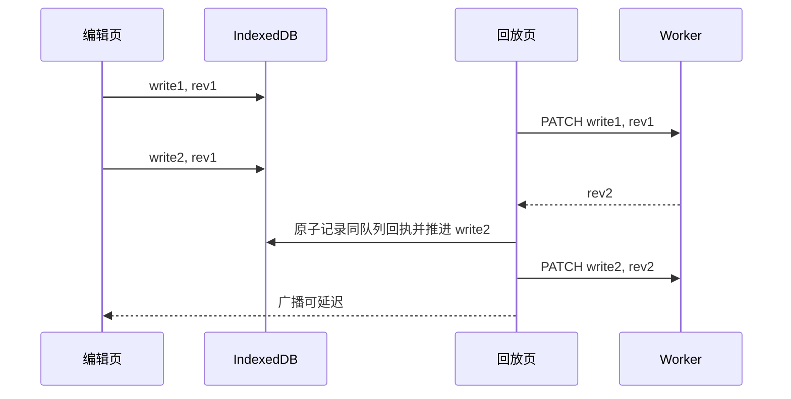

# Design Document

## Overview

已确认自动副本入口为 `replayOutboxNow` 收到 409 后的冲突恢复。导航只写 History，没有直接生成副本。修复限于自动保存和本地 outbox 的版本推进，不更改 UI。

## Components

1. `notes.ts`：正文回放与 `patchNote` 共用 `enqueueNoteWrite`，在真正执行时重新读取 dirty/durable 版本。保留真正 409 的恢复分支。
2. `db.ts`：在用户命名空间内保存按 queueId 隔离的已确认写入回执，记录 noteId、clientId、连续已确认版本区间及最后 writeId。回执与 outbox 后继推进使用同一个 IndexedDB readwrite transaction。
3. 后继 enqueue 和 updateOutboxRevision 只利用同 queueId、同 noteId、同 clientId 的连续已确认区间；不降低已有 durable rev。不能按 noteId 统一提高所有编辑者的版本。
4. 保存完成后先持久化回执、推进同槽位后继，再清理已提交 writeId 和发送广播。广播只负责及时更新 UI，不承担正确性的唯一保证。

## Data Flow

## Error Handling

- 无法持久化保存回执时保留队列并报告失败，不把成功 PATCH 误当成可安全清理。
- 回执只证明同一编辑序列；独立编辑者不同内容的 409 继续保全为 copy。
- 旧客户端不会读取新回执，发布说明要求重新加载已打开页面；存储仍保留原 outbox 数组兼容性。
- 不处理生产已有副本，不改认证、D1 schema、Cloudflare 绑定。

## Testing Strategy

- 先红后绿：元数据与正文交叠；外部 client 回放时同槽位替换；广播未到达且已清理槽位后继续输入；多个连续保存回执；旧版本写入不倒退；独立客户端仍冲突。
- 单页新建与标题正文连续编辑、双页回放和网络延迟使用隔离本地真实浏览器。
- 完整项目门禁、隔离 API E2E、备份后发布、线上资源及健康权限验证。
