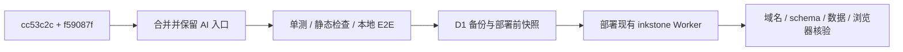

# Design Document

## Overview

复用 upstream-v080-sync 的合并、五道门和生产核验流程。当前工作树干净；`git merge-tree` 已量到 5 个冲突文件。

## Steering Document Alignment

遵守 CONTRIBUTING.md；不创建新架构层，不改变生产资源 ID。流程说明落本 spec 和私有 `docs/`。

## Code Reuse Analysis

### Existing Components to Leverage
- `src/client/features/ai/`、`src/client/lib/ai/`、`src/worker/routes/ai.ts` 保留现有实现。
- 复用上游复制链接、查找替换浮窗、阅读位置及备份计划实现。
- 本地 `9fc3498` 附件引用修复与上游对应文件一致，无需再次移植。

### Integration Points
- 冲突：CommandPalette、SettingsPanel、sections、EditorToolbar、Workspace。菜单合并同时保留上游和 AI 入口；`onEditorReady` 继续经过维护 active editor 的 `setView`。
- 自动合并也检查 CodeEditor 的 `aiStreamUpdate`、AppShell 对话框和 locale。

## Architecture

## Components and Interfaces

沿用现有 API，不自建新接口。部署用已安装 Wrangler，凭据从 Cloudflare skill 指定文件字面解析到子进程环境，不打印。

## Data Models

上游 v13 新增 `backup_archives` 与索引；已有数据表不做自定义迁移。生产快照包括笔记、未删除笔记、附件、版本和 FTS 行数。

## Error Handling

- 合并失败逐块处理，不用整文件 ours/theirs，不在 merge 中 stash。
- 门禁失败先归因；必要时纯上游临时 worktree 对照。
- 部署失败保留现有线上版本；已部署后的问题优先 Worker rollback，D1 restore 需独立判断，不能混同。

## Testing Strategy

全量 Vitest 和项目必需检查，新增有意义的合并入口回归断言；`INKSTONE_EPHEMERAL_DEV=1` 隔离本地 E2E。浏览器用本会话新 tab。生产当前 Chrome 未登录，先核实可用登录渠道；不为测试创建生产用户或改私人笔记。

## 本设计押的数（Assumptions to be checked）

| 押的 | 值 |
| --- | --- |
| 官方新增提交 | 18，已 fetch 实测 |
| 冲突文件 | 5，merge-tree 实测 |
| schema 版本 | 12 → 13，源码实测，线上待验 |
| 当前生产计数 | 未量，部署前读取 |
| 本地 E2E | 预计可沿用现有脚本，待运行 |

## Constitution Gates（宪法自检）

- [x] 简洁门：只同步、解冲突、验证和部署。
- [x] 反抽象门：无新产品抽象。
- [x] 复用门：已读前两轮 spec/log 与既有模块。
- [x] 精准门：不改用户笔记和既有分享状态。
